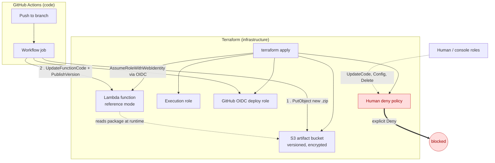

# terraform-aws-lambda-s3-reference

A Terraform module for a Lambda function that runs in **reference mode**. The
function reads its deployment package from an S3 bucket you own, and GitHub
Actions deploys new code. The module also sets up the bucket, the roles, the
GitHub OIDC trust, and an optional deny policy that blocks direct console edits.

Terraform manages the infrastructure and settings. The pipeline manages the code.

## How it works



The pipeline is the only path that changes the function. Human roles listed in
`human_role_names` are blocked from editing the Lambda directly; the deploy role
is never covered by the deny, so CI/CD keeps working.

## What it creates

| Resource | Purpose |
|---|---|
| S3 bucket | Artifact store. Versioned, encrypted with SSE-S3, public access blocked |
| Bucket policy | Lets the Lambda service read `functions/*`, scoped to this function. Optionally denies deletes for everyone |
| Seed object | The first package, uploaded from `seed_zip_path` |
| Lambda function | Created from the seed package, then switched to reference mode |
| Log group | Retention set by `log_retention_days` |
| Execution role | Basic logging, plus an optional inline policy you supply |
| Deploy role | Assumed by GitHub Actions through OIDC. Can update code and publish, nothing else |
| Deny policy | Optional. Blocks code and configuration edits by named human roles |

## Usage

From the Terraform Registry:

```hcl
module "lambda_function" {
  source  = "aquavis12/lambda-s3-reference/aws"
  version = "~> 1.0"

  function_name     = "my-function"
  handler           = "main.handler"
  seed_zip_path     = "${path.module}/seed/bootstrap.zip"
  github_repository = "aquavis12/my-repo"
  github_subjects   = ["environment:main"]
}
```

Or straight from Git, pinned to a release tag:

```hcl
module "lambda_function" {
  source = "git::https://github.com/aquavis12/terraform-aws-lambda-s3-reference.git?ref=v1.0.0"

  function_name     = "my-function"
  handler           = "main.handler"
  seed_zip_path     = "${path.module}/seed/bootstrap.zip"
  github_repository = "aquavis12/my-repo"
  github_subjects   = ["environment:main"]
}
```

`seed_zip_path` must point at a real zip built for your runtime and
architecture. `examples/basic/seed/bootstrap.zip` is a placeholder for a quick
`terraform plan`; replace it with your own package before `apply`.

See `examples/basic` for a complete example. Outputs include `artifact_bucket`
and `deploy_role_arn`. Set those as `ARTIFACT_BUCKET` and `AWS_DEPLOY_ROLE_ARN`
in the GitHub Environment, and set `FUNCTION_NAME` to `function_name`.

## Requirements

- Terraform 1.5 or later, with AWS provider 6.0 or later
- AWS CLI 2.35.12 or later on the machine that runs `terraform apply`. The
  reference-mode switch uses it, because the Terraform AWS provider does not
  yet support the storage mode.
- The applier needs `lambda:UpdateFunctionCode`, `lambda:GetFunction`,
  `lambda:GetFunctionConfiguration`, and `s3:PutObject` on the bucket.
- A zip package built for the runtime and architecture you set. Python packages
  go in the zip. Only compiled binaries belong in layers.

## Known limitations

**Reference mode is a local-exec step.** The AWS provider does not yet expose
`s3_object_storage_mode` on `aws_lambda_function`. The `terraform_data.reference_mode`
resource runs the CLI instead. It re-runs when the seed package changes.
When the provider adds the argument, replace that resource with the argument
and remove the local-exec.

**Code is ignored after creation.** `ignore_changes` covers the code attributes.
Terraform will not change code on later applies. Deploy code through the
pipeline. A code change made directly through Terraform would also reset the
storage mode, if the reference step did not run again.

**Destroy needs a manual step when deletion is denied.** With
`deny_artifact_deletion = true`, no principal can delete objects or versions, so
`terraform destroy` cannot empty the bucket. To tear down:

1. Detach the deny policy and the bucket policy deny statement, or apply with `deny_artifact_deletion = false`.
2. Delete all object versions and delete markers in the bucket.
3. Run `terraform destroy`.

Do this under a change request. It is intentional friction.

**Retention is off by default.** `noncurrent_version_expiry_days` is null. A
lifecycle rule that expires old versions can break a published version that
still points at them. Turn it on only after checking the versions in use.

**Pinning the function to the pipeline.** Once a human-deny policy is attached,
`UpdateFunctionConfiguration` is also blocked for those roles. Changes to memory,
timeout or layers then need the policy detached first.

## Development status

The module passes `terraform fmt` and `terraform validate` with AWS provider 6.x.
It has **not** yet been run with `terraform plan` or `apply` against an AWS
account. Run both in a sandbox account before using it for production.

## Versioning

Tag releases with semantic versions. Consumers pin a tag with `?ref=vX.Y.Z`.
